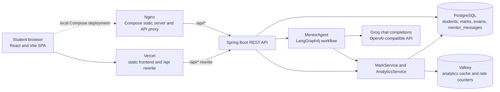

# EduMentor

**A full-stack learning dashboard for academic records, performance analytics,
exam planning, and AI-assisted study.** EduMentor combines a React single-page
application with a Spring Boot API, PostgreSQL persistence, Valkey-backed
analytics caching, and a Groq-powered mentor workflow.

[Live frontend](https://edu-mentor-two.vercel.app) ·
[Backend](https://edu-mentor-1.onrender.com) ·
[Source repository](https://github.com/rajath88/edu-mentor)

[](https://github.com/rajath88/edu-mentor/actions/workflows/ci.yml)

## What it does

- **Academic dashboard:** displays the registered student's recorded marks,
  averages, subject analytics, and upcoming exams from the backend.
- **Marks and exams:** create marks and exams, view saved records, and delete
  exams through the REST API. Records are stored in PostgreSQL.
- **Performance analytics:** calculates overall and subject averages, score
  trends, weakest topics, and upcoming exam dates. Analytics are cached in
  Valkey and invalidated when marks or exams change.
- **AI Study Mentor:** sends a student's question and current academic analytics
  through a LangGraph4j workflow. The answer is reviewed and can be revised
  before being returned. Recent saved messages are displayed in the UI.
- **Markdown answers:** renders mentor responses with headings, lists, tables,
  and code blocks while leaving raw HTML disabled.
- **Courses and quizzes:** offers four topic-based courses and Java/Data
  Structures quizzes. Completed topics and quiz attempts are saved in browser
  `localStorage`; they are not backend records and do not sync between devices.

### Feature and persistence status

| Feature                             | Status                  | Data source                                                             |
| ----------------------------------- | ----------------------- | ----------------------------------------------------------------------- |
| Student profile creation            | Implemented             | PostgreSQL; current browser keeps the student ID/name in `localStorage` |
| Marks create/list                   | Implemented             | PostgreSQL REST API                                                     |
| Exam create/list/delete             | Implemented             | PostgreSQL REST API                                                     |
| Dashboard and analytics             | Implemented             | Backend analytics and academic-record APIs                              |
| AI Mentor and recent history        | Implemented             | Groq API for answers; PostgreSQL for saved messages                     |
| Course topics and progress          | Implemented in frontend | Static course content; progress in browser `localStorage`               |
| Java and Data Structures quizzes    | Implemented in frontend | Static questions; scores/history in browser `localStorage`              |
| Authentication and account recovery | Not implemented         | —                                                                       |
| Marks update/delete                 | Not implemented         | No corresponding API endpoints                                          |

## Screenshots

No application screenshots are currently checked into the repository. Replace
these placeholders with genuine captures when available.

| Dashboard                                             | Courses and progress                                |
| ----------------------------------------------------- | --------------------------------------------------- |
| _Screenshot placeholder: `docs/images/dashboard.png`_ | _Screenshot placeholder: `docs/images/courses.png`_ |

| Marks and analytics                                   | AI Mentor                                          |
| ----------------------------------------------------- | -------------------------------------------------- |
| _Screenshot placeholder: `docs/images/analytics.png`_ | _Screenshot placeholder: `docs/images/mentor.png`_ |

## Architecture



The diagram shows the configured routes and integrations. The Vercel rewrite
points to the supplied Render backend URL. The Compose topology uses Nginx and
the Spring Boot service; PostgreSQL and Valkey are configured dependencies. The
repository does not include a Render Blueprint or provision cloud database/cache
resources.

### Request and data flow

1. The React UI sends JSON requests through Axios to `/api`. In development it
   defaults to `http://localhost:8080/api`; in production, Vercel's rewrite
   forwards `/api/*` to Render.
2. `ApiController` validates request records and delegates mark, exam, and
   analytics operations to services and Spring Data repositories.
3. PostgreSQL stores student profiles, marks, exams, and successful mentor
   exchanges. Flyway applies the checked-in SQL migration; Hibernate validates
   the resulting schema.
4. `AnalyticsService` computes per-subject summaries and caches them in Valkey
   for ten minutes. Mark and exam writes evict the student's cached analytics.
5. For mentor questions, the API applies a Valkey-backed best-effort per-IP rate
   limit, loads analytics, and invokes the graph. The graph asks the configured
   Groq model for an answer, critiques it, and may make up to two revision
   passes. The controller stores the question/answer pair and returns the answer
   as JSON.

The mentor history endpoint returns up to ten messages, newest first. The UI
displays history, but previous messages are not included as conversational
context in the model prompt.

## Technology stack

| Area                                 | Technologies                                                                                      |
| ------------------------------------ | ------------------------------------------------------------------------------------------------- |
| Frontend                             | React 19, JavaScript, Vite 8, Axios                                                               |
| UI and charts                        | Tailwind CSS 4, Lucide React, Recharts, ReactMarkdown, remark-gfm                                 |
| Backend                              | Java 21, Spring Boot 3.4, Spring MVC, Spring Data JPA, Jakarta Validation, Spring Cache, Actuator |
| Database and migrations              | PostgreSQL, Hibernate/JPA, Flyway                                                                 |
| Caching and rate limiting            | Valkey with Spring Data Redis and Spring Cache                                                    |
| AI                                   | Groq via the OpenAI-compatible API, LangChain4j 1.3, LangGraph4j 1.6                              |
| Local packaging and proxy            | Docker, Docker Compose, Nginx                                                                     |
| Frontend hosting and backend hosting | Vercel and Render                                                                                 |
| CI                                   | GitHub Actions; Node.js 22 frontend job and Java 21/Maven backend job                             |

The POM also contains a LangChain4j Ollama adapter, but the active `AiConfig`
bean uses `OpenAiChatModel` configured for Groq. Ollama is not the active AI
provider.

## API reference

All application API routes are under `/api`. Request and response bodies use
JSON unless noted. `{id}` is a student ID.

| Method and route                           | Purpose and request                                                                                                                                                                       |
| ------------------------------------------ | ----------------------------------------------------------------------------------------------------------------------------------------------------------------------------------------- |
| `POST /api/students`                       | Create a profile. Body: `{"name":"Taylor Student","email":"taylor@example.test"}`; email is optional. Returns `201`.                                                                      |
| `POST /api/students/{id}/marks`            | Add a mark. Body: `{"subject":"Mathematics","topic":"Algebra","score":18,"maxScore":20,"takenOn":"2026-11-12"}`. `takenOn` is optional; returns `201`.                                    |
| `GET /api/students/{id}/marks`             | List marks ordered by date ascending.                                                                                                                                                     |
| `POST /api/students/{id}/exams`            | Add an exam. Body: `{"subject":"Mathematics","examDate":"2026-12-01"}`; returns `201`.                                                                                                    |
| `GET /api/students/{id}/exams`             | List exams ordered by date ascending.                                                                                                                                                     |
| `DELETE /api/students/{id}/exams/{examId}` | Delete an exam belonging to the specified student; returns `204`.                                                                                                                         |
| `GET /api/students/{id}/analytics`         | Return `studentId`, `marksCount`, `averageScore`, `subjects`, and upcoming exams. Subject summaries include `average`, `trend`, `weakestTopic`, and `daysToExam`.                         |
| `POST /api/mentor/{id}/ask`                | Ask the mentor. Body: `{"question":"Explain binary search."}`; successful responses contain `{"answer":"..."}`. Provider failures return a safe error response; rate limits return `429`. |
| `GET /api/mentor/{id}/history`             | Return up to ten saved mentor messages, newest first.                                                                                                                                     |
| `GET /actuator/health`                     | Spring Boot health endpoint; not under `/api`.                                                                                                                                            |

Validation is applied to required names, subjects, topics, exam dates, question
text, and numeric bounds (`score >= 0`, `maxScore > 0`). Invalid request bodies
are rejected by Spring validation; missing students and exams map to `404`.
The mentor endpoint returns `502` for provider/workflow failures and `429` when
the per-IP rate limit is exceeded. A nonnumeric or `null` mentor student ID
currently returns `200` with a friendly answer message. The API does not
currently enforce `score <= maxScore`. There are no mark update/delete routes.
Exam deletion checks ownership against the student ID in the route. **The API
has no authentication or authorization**, so IDs must not be treated as access
credentials.

## Local development

### Prerequisites

- Git
- Node.js 22 and npm
- Java 21 and Maven 3.9+
- Docker Engine and Docker Compose (recommended for PostgreSQL and Valkey)
- A Groq API key for running the backend, including its AI Mentor bean

### Run the full Compose topology

Copy the sample environment file and edit `.env`. Set a non-placeholder database
password and a real Groq key; the application intentionally fails startup when
`LLM_API_KEY` is blank.

```powershell
Copy-Item .env.example .env
# Edit .env and set DB_PASSWORD and LLM_API_KEY, then:
docker compose up --build
```

Open [http://localhost](http://localhost) for the Nginx-served UI. The API is
also published at `http://localhost:8080/api`. Compose provides PostgreSQL and
Valkey on its internal network and persists PostgreSQL data in the `pgdata`
volume.

The Compose Nginx service mounts the checked-in `nginx/html` directory; the
Dockerfile builds only the backend JAR and does not build or copy
`frontend/src`. For frontend source development, use Vite instead:

```powershell
cd frontend
npm ci
npm run dev
```

Vite serves the source UI at `http://localhost:5173` and its development API
default targets `http://localhost:8080/api`. Keep the Compose backend running,
or set `VITE_API_BASE_URL` to the API URL you use. Build production frontend
assets with `npm run build` from `frontend`; output goes to `frontend/dist`.

### Run the backend outside Compose

Start reachable PostgreSQL and Valkey services, configure the variables below,
then run from the repository root:

```powershell
mvn spring-boot:run
```

The default database connection targets `localhost:5432/edumentor`; the defaults
for the local database username/password are `edumentor`. Flyway runs at
application startup and Hibernate validates the schema. Spring resolves its
listen port in this order: `PORT`, `SERVER_PORT`, then `8080`.

## Configuration

The root `.env.example` documents the local Compose settings. Keep actual
credentials in `.env` or a deployment secret store; `.env` is ignored by Git.
Never place `LLM_API_KEY` in Vite variables or frontend code.

| Variable                          | Used by                                | Default / behavior                                                                                                                                                            |
| --------------------------------- | -------------------------------------- | ----------------------------------------------------------------------------------------------------------------------------------------------------------------------------- |
| `PORT`                            | Spring Boot / hosting platform         | Highest port priority when supplied, including Render's injected port.                                                                                                        |
| `SERVER_PORT`                     | Spring Boot and Compose                | Fallback port; Spring ultimately defaults to `8080`.                                                                                                                          |
| `SERVER_ADDRESS`                  | Compose / Spring Boot binding          | Compose sets `0.0.0.0`; application configuration also defaults to that address.                                                                                              |
| `DB_URL`                          | Spring datasource                      | `jdbc:postgresql://localhost:5432/edumentor`; Compose uses `jdbc:postgresql://postgres:5432/edumentor`.                                                                       |
| `DB_USER`                         | Spring datasource                      | `edumentor` in the application and Compose configuration.                                                                                                                     |
| `DB_PASSWORD`                     | Spring datasource and Compose Postgres | Required for a real deployment. Compose's `change-me` fallback is a development placeholder and must be replaced.                                                             |
| `VALKEY_HOST`                     | Spring Data Redis                      | `localhost` for a local process; Compose sets `valkey`. Host only, without a port suffix.                                                                                     |
| `VALKEY_PORT`                     | Spring Data Redis                      | `6379`.                                                                                                                                                                       |
| `LLM_API_KEY`                     | Backend AI configuration               | Required for backend startup; supply as a secret. Never expose it to the browser.                                                                                             |
| `LLM_MODEL`                       | Backend AI configuration               | `openai/gpt-oss-120b`.                                                                                                                                                        |
| `LLM_BASE_URL`                    | Backend AI configuration               | Optional override; defaults to `https://api.groq.com/openai/v1/`.                                                                                                             |
| `CORS_ALLOWED_ORIGINS`            | Backend CORS and rate-limit responses  | `http://localhost,http://localhost:5173,https://*.vercel.app`; comma-separated origin patterns.                                                                               |
| `VITE_API_BASE_URL`               | Frontend build/runtime config          | Optional. Development fallback is `http://localhost:8080/api`; production fallback is `/api`, which Vercel rewrites to Render. This is a public API URL only, never a secret. |
| `OLLAMA_BASE_URL`, `OLLAMA_MODEL` | Compose pass-through only              | Present in Compose, but not consumed by the active Groq `AiConfig`.                                                                                                           |

## Testing and CI

Frontend checks (from `frontend`):

```bash
npm ci
npm run lint
npm test
npm run build
```

Backend checks (from the repository root):

```bash
mvn clean test package -Dnet.bytebuddy.experimental=true
```

The frontend tests cover Markdown rendering/safety, local course-progress
persistence, quiz scoring, and quiz-history storage. Backend tests cover service
calculations, mark operations, Valkey host normalization, mentor error handling,
and rate-limit behavior. The checked-in GitHub Actions workflow runs these
frontend checks with Node.js 22 and the Maven test/package command with Java 21
on pushes and pull requests targeting `main`. The workflow does not configure
PostgreSQL, Valkey, or live AI credentials; the current automated tests use
isolated/unit-level checks.

## Deployment

### Vercel frontend

`frontend/vercel.json` contains two rewrites: `/api/:path*` goes to
`https://edu-mentor-1.onrender.com/api/:path*`, and other paths fall back to
`/index.html` for SPA navigation. Configure the Vercel project root as
`frontend`, build with `npm run build`, and publish `dist`. The default
production Axios base URL `/api` uses the checked-in API rewrite. If overriding
`VITE_API_BASE_URL`, set only a public API URL and rebuild.

### Render backend

The root `Dockerfile` builds the Maven JAR using Java 21 and runs it on a Java
21 JRE image. Configure the Render service to build from the repository root
with this Dockerfile. Supply `LLM_API_KEY`, `DB_URL`, `DB_USER`, `DB_PASSWORD`,
`VALKEY_HOST`, and `VALKEY_PORT` through Render's service environment/secrets.
The app accepts Render's `PORT` without hard-coding a production port. Configure
`CORS_ALLOWED_ORIGINS` if the frontend uses a custom domain not covered by the
default Vercel pattern. `/actuator/health` is exposed for health checks.

### Local Docker Compose

Compose runs Nginx on host port `80`, publishes the backend on `127.0.0.1:8080`,
and connects the backend to PostgreSQL and Valkey by service hostname. Nginx
serves `nginx/html` and proxies `/api/` and `/actuator/health` to the backend.
It does not run a frontend build; use Vercel or the Vite development server for
the source frontend, or refresh `nginx/html` from a production build when
maintaining the Compose static UI.

## Limitations and project status

- **Identity:** profile creation is not sign-in. The browser restores a saved
  student ID/name from `localStorage`; there is no authentication,
  authorization, or email-based account recovery. A student ID is not a security
  boundary.
- **Browser-local features:** course content is static, and course
  completion/quiz attempts are kept in browser `localStorage`, not PostgreSQL.
  They do not synchronize across devices or browsers.
- **Academic records:** marks support create/list only. The frontend checks that
  a mark score does not exceed the maximum, but the backend request validation
  does not currently enforce that upper bound.
- **Mentor context:** saved history is displayed but previous turns are not fed
  into the next model prompt. Answers depend on the current question and
  analytics context and may be inaccurate.
- **Runtime dependencies:** PostgreSQL and a non-empty `LLM_API_KEY` are
  required for backend startup. Valkey backs analytics caching and rate
  limiting; the rate limiter is best-effort when Valkey has a data-access
  error.
- **Deployment scope:** Vercel rewrite and Docker/Compose configuration are
  checked in; there is no Render Blueprint. Links above are the project's
  published endpoints, but this README does not assert that a deployment is
  currently healthy.

## Future improvements

Potential next steps (not currently implemented): secure authentication and
student-level authorization; database-backed course content and progress;
persistent quiz attempts and richer question sets; mark update/delete APIs;
optional mentor conversation context; and browser-level CI coverage against
disposable service containers.

## Author

**EduMentor project author:** [@rajath88 on GitHub](https://github.com/rajath88)
